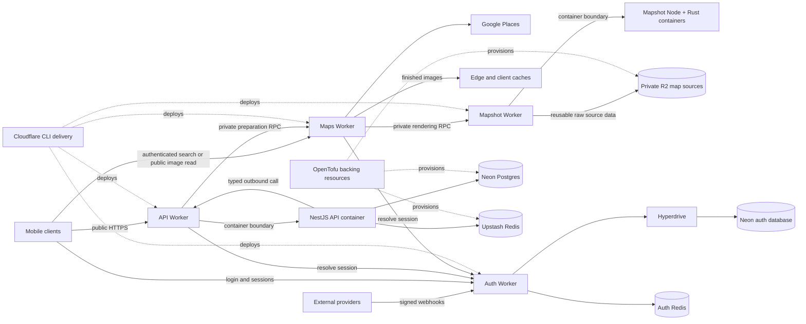

<h1 align="center">Cataquí Backend</h1>

<p align="center">
  The backend for discovering and posting real local work—fast, nearby, and without corporate hiring friction.
</p>

<p align="center">
  <a href="https://github.com/Cataqui/backend/actions/workflows/ci.yml"></a>
  
  
  
</p>

<p align="center">
  <a href="#start-here">Start here</a> ·
  <a href="#architecture">Architecture</a> ·
  <a href="#quick-start">Quick start</a> ·
  <a href="#development-workflow">Development</a> ·
  <a href="#operations-documentation">Operations</a> ·
  <a href="#guide-for-coding-agents">Agent guide</a> ·
  <a href="#infrastructure">Infrastructure</a>
</p>

Cataquí is the real-time opportunity layer of the city: a hyperlocal feed for quick jobs, gigs, side hustles, and short-term freelance work. This monorepo owns the private user API, independently deployed edge services, shared runtime contracts, and the infrastructure that operates them.

The product has two core journeys:

- **Workers** open the feed and quickly find trustworthy opportunities nearby.
- **Posters** publish local work with minimal setup and connect with workers through familiar channels.

Every backend decision should reinforce fast discovery, low friction, local relevance, freshness, and trust. Cataquí is not an applicant-tracking system, staffing ERP, or corporate recruiting platform.

## Start here

Install the [base tools](#prerequisites), then verify a fresh checkout without cloud credentials or a running database:

```sh
git clone https://github.com/Cataqui/backend.git
cd backend
pnpm install --frozen-lockfile
pnpm test:api
```

Success means the core API test suite completes. To start a service, continue to [Quick start](#quick-start); live development requires maintainer-provided credentials and already provisioned backing services.

## Architecture

The system keeps core product behavior in NestJS while placing edge-specific, provider-specific, and independently scalable concerns in Cloudflare Workers.



The important boundaries are:

- **Core product API requests** enter through the API Worker, which selects and forwards to the NestJS container. Public traffic never reaches internal routes.
- **Narrow public ingress** enters directly through Maps or Auth, where edge authentication and provider-specific validation belong.
- **Maps is one Worker** with place search and static-image delivery capabilities.
- **Mapshot generates static map images** with Node orchestration and a native Rust renderer, and owns source preparation and private storage. Its private Worker and containers share a coordinated release; Maps owns the product-facing URLs and image caches
- **Immediate private work** crosses named Worker RPC Service Bindings—never synthetic internal URLs or shared-secret headers.
- **Internal communication** uses Cloudflare's typed Service Bindings between Workers and `@cataqui/workerhole` between Workers and their Node containers. Applications expose their owned contracts through compiled public exports.
- **Durable product state** belongs in PostgreSQL; shared ephemeral coordination belongs in Redis.

### Technology at a glance

| Concern | Technology |
| --- | --- |
| Core API | NestJS, Fastify, Zod, Prisma |
| Edge services | Cloudflare Workers, Hono, Containers |
| Data | PostgreSQL on Neon, Upstash Redis |
| Infrastructure | OpenTofu, Cloudflare, Google Cloud, Infisical |
| Tooling | Node.js 24, TypeScript 6, pnpm, Ruby, Bundler, Biome, Vitest, Cloudflare CLI, Wrangler |

## Quick start

### Run services with Cataquí development access

### Prerequisites

For every project, install [Git](https://git-scm.com/), [Node.js 24](https://nodejs.org/) (24.15.0 or newer within 24.x), and **pnpm 11.28.0**. Then add only the tools needed for your work:

| Project or workflow | Additional tools to install |
| --- | --- |
| NestJS API development and tests, shared packages, or Maps/Auth Worker development in isolation | Base tools only |
| Repository automation and root checks | [Ruby](https://www.ruby-lang.org/en/documentation/installation/) at the version in `.ruby-version`, then `bundle install` for locked gems |
| Mapshot development, builds, tests, or typechecking; API Worker + Container development | [Docker](https://www.docker.com/) with its daemon running; Mapshot also uses Ruby for local command orchestration |
| Infrastructure development, `pnpm check:opentofu`, or the full `pnpm check` gate | Ruby and [OpenTofu 1.12.6](https://opentofu.org/docs/intro/install/) |
| Privileged infrastructure bootstrap only | OpenTofu plus [GitHub CLI](https://cli.github.com/), [Google Cloud CLI](https://cloud.google.com/sdk/docs/install), and [Infisical CLI](https://infisical.com/docs/cli/overview); follow the [bootstrap runbook](docs/infrastructure-bootstrap.md) |

The focused `pnpm test:api`, `pnpm test:maps`, and `pnpm test:auth` commands need only the base tools. Root `pnpm test`, `pnpm test:cov`, `pnpm typecheck`, and `pnpm build` include Mapshot and require Ruby and Docker. `pnpm check` additionally requires OpenTofu and the locked Ruby gems.

> [!IMPORTANT]
> Each application's `.env.example` defines its local configuration, but its placeholders do not form a runnable environment. Ask a maintainer for development-scoped values. Never commit `.env` or reuse staging/production credentials locally.

### Run the NestJS API

```sh
git clone https://github.com/Cataqui/backend.git
cd backend
pnpm install --frozen-lockfile
cp apps/api/.env.example apps/api/.env
# Fill apps/api/.env with development-scoped API values.
pnpm --filter @cataqui/api prisma:generate
pnpm --filter @cataqui/api start:dev
```

When startup succeeds:

- API status (authenticated through the Worker): `/`
- Readiness: <http://localhost:3000/v1/health>
- Liveness: <http://localhost:3000/v1/health/live>
- Swagger UI: <http://localhost:3000/docs>

Swagger is available outside production. The public API uses versioned `/v1/...` routes; the root status endpoint is intentionally version-neutral.

### Choose the local topology

Start only the processes required by the boundary under test:

| Flow | Start | Required dependency |
| --- | --- | --- |
| Core API behavior in isolation | API tests | Mocked database, Redis, and authenticated ingress |
| Job creation with map URLs and image delivery | Auth Worker, API Worker + Container, Maps Worker, and Mapshot Worker + Container | Docker, each application's local environment, and prepared Mapshot source data |
| API edge, outbound call, or Container behavior | Auth Worker and API Worker + Container | Docker and the API/Auth local environments |
| Authenticated address search | Auth Worker and Maps Worker | A development access token and Google Places credentials |
| WhatsApp login | Auth Worker | Dedicated Auth database, Redis, and signed Meta callbacks |

API and Mapshot keep their Node application in `src/` and Cloudflare code in a separate `worker/` workspace. Each runtime owns its dependencies and tests; each pair shares a release.

Copy the `.env.example` beside each application to `.env` and fill only that application's values. Run `pnpm build:contracts` before starting Workers, then use the owning workspace so Cloudflare configuration and local environment paths resolve correctly:

```sh
# API Worker + Container boundary
pnpm --filter @cataqui/api-worker cf:dev

# Authenticated address search
pnpm --filter @cataqui/maps-worker cf:dev

# Provider webhook ingress
pnpm --filter @cataqui/auth-worker cf:dev

# AI Worker development
pnpm --filter @cataqui/ai-worker cf:dev
```

Use Auth OpenAPI for WhatsApp login and session operations. API and Maps accept the same opaque access token. Each app loads its own local environment; Auth's database and Redis credentials are independent of API's. API clients enter through the API Worker; a direct NestJS process is useful for health checks and isolated tests.

The repository does not provide local PostgreSQL/Redis containers or seed data. A maintainer-provided development environment must already be provisioned and migrated. Do not run a development migration against a shared database unless the change requires it and the target has been explicitly confirmed.

## Development workflow

### 1. Start from the owning instructions

Read [`AGENTS.md`](AGENTS.md), then the closest nested `AGENTS.md` for every file you will change. Nested files define domain-specific architecture, security, testing, and delivery rules. Relevant skills live in [`.agents/skills`](.agents/skills) and should be checked before implementation.

### 2. Validate from narrow to broad

The root scripts build shared packages before dependent consumers where required.

| Goal | Command |
| --- | --- |
| Install exactly the locked dependency graph | `pnpm install --frozen-lockfile` |
| Install locked automation gems | `bundle install` |
| Check formatting and linting without modifying files | `pnpm lint:check` |
| Format and apply safe Biome fixes | `pnpm format` |
| Type-check every workspace and generated Worker binding | `pnpm typecheck` |
| Run all tests | `pnpm test` |
| Run bootstrap automation tests without provider credentials | `pnpm ruby:test` |
| Run all four-metric 90% coverage gates | `pnpm test:cov` |
| Build packages, API, and Worker dry runs | `pnpm build` |
| Validate OpenTofu formatting, initialization, configuration, and tests | `pnpm check:opentofu` |
| Run the complete repository gate | `pnpm check` |

Focused application tests:

```sh
pnpm test:api
pnpm test:maps
pnpm test:mapshot
pnpm test:auth
```

Focused package tests:

```sh
pnpm --filter @cataqui/workerhole test
pnpm --filter @cataqui/response test
```

> [!CAUTION]
> `cf:deploy:*`, `cf:secret:put`, `prisma:migrate:*`, and `infrastructure:bootstrap` can mutate shared or live systems. Run them only with explicit authorization after confirming the environment and target. `pnpm clean` deletes local generated output, coverage, and builds.

### Database changes

API and Auth each own their Prisma schema and migrations under their own `prisma/schema` directory. The application uses separate database roles: a least-privilege pooled URL at runtime and a privileged direct URL for migrations.

```sh
# Validate and regenerate the Prisma client
pnpm --filter @cataqui/api prisma:validate
pnpm --filter @cataqui/api prisma:generate

# Create/apply a development migration against DATABASE_OWNER_DIRECT_URL
pnpm --filter @cataqui/api prisma:migrate:dev

# Inspect the configured database
pnpm --filter @cataqui/api prisma:studio
```

> [!WARNING]
> Prisma migration and Studio commands connect to the database configured in `.env`. Confirm the target before running them. Infrastructure readiness precedes migration, and migration precedes API deployment.

## Configuration and secrets

Each application owns a local `.env` and a committed `.env.example`. API and Mapshot keep theirs at the application root for their Worker/container ecosystem. Standalone Workers keep theirs beside their Cloudflare configuration. The repository root has no application environment file.

| Application | Local environment example |
| --- | --- |
| API | [`apps/api/.env.example`](apps/api/.env.example) |
| Auth | [`apps/workers/auth/.env.example`](apps/workers/auth/.env.example) |
| AI | [`apps/workers/ai/.env.example`](apps/workers/ai/.env.example); no local runtime secrets currently required |
| Maps | [`apps/workers/maps/.env.example`](apps/workers/maps/.env.example) |
| Mapshot | [`apps/mapshot/.env.example`](apps/mapshot/.env.example); no local runtime secrets currently required |

`cloudflare.config.ts` owns runtime settings and binding topology. `cf` handles normal development, builds, deployment, and binding type generation; Wrangler remains for specific inspection and SDK operations. Infisical remains the central source for environment-scoped runtime, migration, and release credentials. Each consumer receives its own profile. Native Cloudflare type generation uses declared bindings and secret names, so it does not need local secret files.

| Consumer | Configuration groups |
| --- | --- |
| Core API | Application runtime, CORS, pooled product database access, Cloudflare AI Gateway, and rate-limit Redis |
| Prisma CLI | Privileged direct database URL used only for migration and inspection |
| Maps Worker | Google Places key and static-map URL signing key; private Auth and Mapshot Service Bindings come from Cloudflare configuration |
| Mapshot | Private R2 source data, renderer Containers, and runtime settings come from Cloudflare configuration; release credentials are environment-scoped |
| Auth Worker | Own local environment: Hyperdrive database connection, dedicated Redis, refresh HMAC and Meta verification secrets |

Keep development, staging, and production credentials separate. Secrets belong in the configured secret-management boundary, never source control, shell history, logs, command arguments, OpenTofu outputs, or saved plans. Stable non-secret provider coordinates live in [`infrastructure/platforms.json`](infrastructure/platforms.json); repository-owned resource identities live in [`infrastructure/manifest.json`](infrastructure/manifest.json).

## Guide for coding agents

This README is the repository map; [`AGENTS.md`](AGENTS.md) is the authoritative operating contract. Before acting, read it and every nested `AGENTS.md` down to the target, then select the relevant skill from [`.agents/skills`](.agents/skills). Inspect the owning `package.json` and current configuration instead of inventing commands or contracts. For cross-runtime changes, trace producers, consumers, manifests, generated bindings, and tests before editing; use the validation map above for the first pass and the authoritative handoff gate in `AGENTS.md` for completion.

## Operations documentation

- [`docs/infrastructure-bootstrap.md`](docs/infrastructure-bootstrap.md) explains the privileged, local bootstrap that establishes remote state, provider credentials, identities, and deployment trust.
- [`docs/deployment.md`](docs/deployment.md) covers staging and production deployment, verification, rollback, migration recovery, and escalation.

## Infrastructure

OpenTofu roots under [`infrastructure/opentofu/roots`](infrastructure/opentofu/roots) own independent state keys for each environment and platform concern. The bootstrap exists only to establish state, credentials, identities, and trust that normal roots cannot create without a circular dependency. Follow the [infrastructure bootstrap runbook](docs/infrastructure-bootstrap.md) for the privileged setup and the [deployment runbook](docs/deployment.md) for delivery after bootstrap.

### Validate infrastructure

```sh
pnpm check:opentofu
```

The command checks recursive formatting, initializes every configured root, validates configuration, and runs OpenTofu tests. State and plans are sensitive even when individual attributes are marked `sensitive`.
