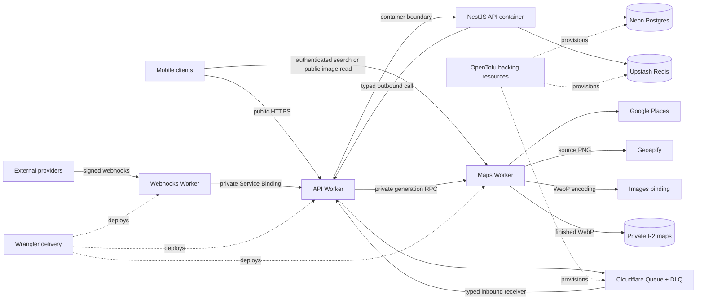

<h1 align="center">Cataquí Backend</h1>

<p align="center">
  The backend for discovering and posting real local work—fast, nearby, and without corporate hiring friction.
</p>

<p align="center">
  <a href="https://github.com/Cataqui/backend/actions/workflows/ci.yml"></a>
  
  
  
</p>

<p align="center">
  <a href="#start-here">Start here</a> ·
  <a href="#architecture">Architecture</a> ·
  <a href="#quick-start">Quick start</a> ·
  <a href="#development-workflow">Development</a> ·
  <a href="#operations-documentation">Operations</a> ·
  <a href="#guide-for-coding-agents">Agent guide</a> ·
  <a href="#infrastructure">Infrastructure</a>
</p>

Cataquí is the real-time opportunity layer of the city: a hyperlocal feed for quick jobs, gigs, side hustles, and short-term freelance work. This monorepo owns the private user API, independently deployed edge services, shared runtime contracts, and the infrastructure that operates them.

The product has two core journeys:

- **Workers** open the feed and quickly find trustworthy opportunities nearby.
- **Posters** publish local work with minimal setup and connect with workers through familiar channels.

Every backend decision should reinforce fast discovery, low friction, local relevance, freshness, and trust. Cataquí is not an applicant-tracking system, staffing ERP, or corporate recruiting platform.

## Start here

You can verify a fresh checkout without cloud credentials or a running database:

```sh
git clone https://github.com/Cataqui/backend.git
cd backend
pnpm install --frozen-lockfile
pnpm test:api
```

Success means the core API test suite completes. To start a service, continue to [Quick start](#quick-start); live development requires maintainer-provided credentials and already provisioned backing services.

## Architecture

The system keeps core product behavior in NestJS while placing edge-specific, provider-specific, and independently scalable concerns in Cloudflare Workers.



The important boundaries are:

- **Core product API requests** enter through the API Worker, which selects and forwards to the NestJS container. Public traffic never reaches internal routes.
- **Narrow public ingress** enters directly through Maps or Webhooks, where edge authentication and provider-specific validation belong.
- **Maps is one Worker** with `places` and `static` feature modules. Static owns generation, rendering, storage, and delivery; authentication and error handling are shared across the Worker.
- **Immediate private work** crosses named Worker Service Bindings and typed inbound receivers—never synthetic internal URLs or shared-secret headers.
- **Durable asynchronous work** uses Cloudflare Queues, with retry and dead-letter behavior owned by the API Worker.
- **Container-to-Cloudflare work** uses a typed outbound manifest instead of importing Worker bindings into NestJS feature code.
- **Durable product state** belongs in PostgreSQL; shared ephemeral coordination belongs in Redis.

### Technology at a glance

| Concern | Technology |
| --- | --- |
| Core API | NestJS, Fastify, Zod, Prisma |
| Edge services | Cloudflare Workers, Hono, Containers, Queues |
| Data | PostgreSQL on Neon, Upstash Redis |
| Infrastructure | OpenTofu, Cloudflare, Google Cloud, Infisical |
| Tooling | Node.js 24, TypeScript 6, pnpm, Biome, Vitest, Wrangler |

## Quick start

### Run services with Cataquí development access

### Prerequisites

- [Node.js 24](https://nodejs.org/) and the repository-pinned **pnpm 11.4.0**
- [Git](https://git-scm.com/)
- Access to the Cataquí development database and service credentials
- [OpenTofu](https://opentofu.org/) when changing infrastructure or running the complete `pnpm check` gate
- [Wrangler](https://developers.cloudflare.com/workers/wrangler/) for Worker development; it is installed with the repository dependencies
- [Docker](https://www.docker.com/) only when exercising the API Worker/Container boundary

> [!IMPORTANT]
> [`.env.example`](.env.example) defines the required configuration, but its placeholders do not form a runnable local environment. Ask a maintainer for development-scoped values. Never commit `.env` or reuse staging/production credentials locally.

### Run the NestJS API

```sh
git clone https://github.com/Cataqui/backend.git
cd backend
pnpm install --frozen-lockfile
cp .env.example .env
# Fill .env with development-scoped values.
pnpm --filter @cataqui/api prisma:generate
pnpm --filter @cataqui/api start:dev
```

When startup succeeds:

- API status: <http://localhost:3000/>
- Readiness: <http://localhost:3000/v1/health>
- Liveness: <http://localhost:3000/v1/health/live>
- Swagger UI: <http://localhost:3000/docs>

Swagger is available outside production. The public API uses versioned `/v1/...` routes; the root status endpoint is intentionally version-neutral.

### Choose the local topology

Start only the processes required by the boundary under test:

| Flow | Start | Required dependency |
| --- | --- | --- |
| Core API feature without Worker bindings | Direct NestJS API | Provisioned PostgreSQL and Redis |
| Job creation with map generation | API Worker + Container and Maps Worker | Docker, root `.env`, and Maps provider credentials and bindings |
| API edge, Queue, outbound call, or Container behavior | API Worker + Container | Docker and root `.env` |
| Authenticated address search | Direct NestJS API, then Maps Worker | API JWKS at `localhost:3000`, a development access token, and Google Places credentials |
| Provider webhook delivery | Webhooks Worker + API Worker/Container | A local multi-Worker graph; direct NestJS alone is insufficient |

Use the owning workspace so Wrangler configuration and root `.env` paths resolve correctly:

```sh
# API Worker + Container boundary
pnpm --filter @cataqui/api cf:dev

# Authenticated address search
pnpm --filter @cataqui/maps-worker cf:dev

# Provider webhook ingress
pnpm --filter @cataqui/webhooks-worker cf:dev
```

Use the API Swagger documentation for session sign-in and Maps token issuance during local development. The configured development receiver completes the out-of-band WhatsApp proof. There is no seeded identity or development authentication bypass.

For local webhook-to-API delivery, run the API Worker and Webhooks Worker in separate terminals. Each workspace script loads the root `.env`, and Wrangler connects the matching local service names across development sessions. The explicit API port avoids a collision; send the signed webhook to the URL reported by the Webhooks process.

```sh
# Terminal 1 — private API Worker target
pnpm --filter @cataqui/api cf:dev --port 8788

# Terminal 2 — public webhook ingress
pnpm --filter @cataqui/webhooks-worker cf:dev
```

The repository does not provide local PostgreSQL/Redis containers or seed data. A maintainer-provided development environment must already be provisioned and migrated. Do not run a development migration against a shared database unless the change requires it and the target has been explicitly confirmed.

## Development workflow

### 1. Start from the owning instructions

Read [`AGENTS.md`](AGENTS.md), then the closest nested `AGENTS.md` for every file you will change. Nested files define domain-specific architecture, security, testing, and delivery rules. Relevant skills live in [`.agents/skills`](.agents/skills) and should be checked before implementation.

### 2. Validate from narrow to broad

The root scripts build shared packages before dependent consumers where required.

| Goal | Command |
| --- | --- |
| Install exactly the locked dependency graph | `pnpm install --frozen-lockfile` |
| Check formatting and linting without modifying files | `pnpm lint:check` |
| Format and apply safe Biome fixes | `pnpm format` |
| Type-check every workspace and generated Worker binding | `pnpm typecheck` |
| Run all tests | `pnpm test` |
| Run all four-metric 90% coverage gates | `pnpm test:cov` |
| Build packages, API, and Worker dry runs | `pnpm build` |
| Validate OpenTofu formatting, initialization, configuration, and tests | `pnpm check:opentofu` |
| Run the complete repository gate | `pnpm check` |

Focused application tests:

```sh
pnpm test:api
pnpm test:maps
pnpm test:webhooks
```

Focused package tests:

```sh
pnpm --filter @cataqui/api-internal-ingress test
pnpm --filter @cataqui/microservices-auth-schemas test
```

> [!CAUTION]
> `cf:deploy:*`, `cf:secret:put`, `prisma:migrate:*`, and `infrastructure:bootstrap` can mutate shared or live systems. Run them only with explicit authorization after confirming the environment and target. `pnpm clean` deletes local generated output, coverage, and builds.

### Database changes

The Prisma schema is split by domain under [`apps/api/prisma/schema`](apps/api/prisma/schema). The application uses separate database roles: a least-privilege pooled URL at runtime and a privileged direct URL for migrations.

```sh
# Validate and regenerate the Prisma client
pnpm --filter @cataqui/api prisma:validate
pnpm --filter @cataqui/api prisma:generate

# Create/apply a development migration against DATABASE_OWNER_DIRECT_URL
pnpm --filter @cataqui/api prisma:migrate:dev

# Inspect the configured database
pnpm --filter @cataqui/api prisma:studio
```

> [!WARNING]
> Prisma migration and Studio commands connect to the database configured in `.env`. Confirm the target before running them. Infrastructure readiness precedes migration, and migration precedes API deployment.

## Configuration and secrets

The root [`.env.example`](.env.example) is the authoritative inventory of local values. Wrangler configuration supplies additional non-secret environment values and binding topology.

| Consumer | Configuration groups |
| --- | --- |
| Core API | Application runtime, CORS, pooled database access, Cloudflare AI Gateway, Redis, and authentication keys |
| Prisma CLI | Privileged direct database URL used only for migration and inspection |
| Maps Worker | Google Places and Geoapify keys; JWKS URL, Cloudflare Images, private R2 storage, and generation coordination bindings come from Wrangler |
| Webhooks Worker | Meta signature/verification secrets and NOTP provider configuration |

Keep development, staging, and production credentials separate. Secrets belong in the configured secret-management boundary, never source control, shell history, logs, command arguments, OpenTofu outputs, or saved plans. Stable non-secret provider coordinates live in [`infrastructure/platforms.json`](infrastructure/platforms.json); repository-owned resource identities live in [`infrastructure/manifest.json`](infrastructure/manifest.json).

## Guide for coding agents

This README is the repository map; [`AGENTS.md`](AGENTS.md) is the authoritative operating contract. Before acting, read it and every nested `AGENTS.md` down to the target, then select the relevant skill from [`.agents/skills`](.agents/skills). Inspect the owning `package.json` and current configuration instead of inventing commands or contracts. For cross-runtime changes, trace producers, consumers, manifests, generated bindings, and tests before editing; use the validation map above for the first pass and the authoritative handoff gate in `AGENTS.md` for completion.

## Operations documentation

- [`docs/infrastructure-bootstrap.md`](docs/infrastructure-bootstrap.md) explains the privileged, local bootstrap that establishes remote state, provider credentials, identities, and deployment trust.
- [`docs/deployment.md`](docs/deployment.md) covers staging and production deployment, verification, rollback, migration recovery, and escalation.

## Infrastructure

OpenTofu roots under [`infrastructure/opentofu/roots`](infrastructure/opentofu/roots) own independent state keys for each environment and platform concern. The bootstrap exists only to establish state, credentials, identities, and trust that normal roots cannot create without a circular dependency. Follow the [infrastructure bootstrap runbook](docs/infrastructure-bootstrap.md) for the privileged setup and the [deployment runbook](docs/deployment.md) for delivery after bootstrap.

### Validate infrastructure

```sh
pnpm check:opentofu
```

The command checks recursive formatting, initializes every configured root, validates configuration, and runs OpenTofu tests. State and plans are sensitive even when individual attributes are marked `sensitive`.
